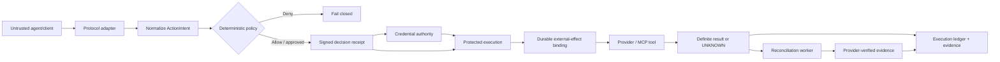

# AgentGuard

**Deterministic runtime authorization and execution-integrity controls for AI agents.**

> **Release status:** `v0.2.0rc3` is a non-production-certified release candidate. The validated development line includes protected MCP stdio and bounded Streamable HTTP profiles, production credential authority, durable external-effect reconciliation, and single-host multi-process coordination. Production promotion still requires independent security review, long-duration operational validation, and a controlled production pilot.

[](https://github.com/TensorScholar/agentguard/actions/workflows/ci.yml)
[](https://github.com/TensorScholar/agentguard/actions/workflows/security.yml)
[](https://github.com/TensorScholar/agentguard/actions/workflows/codeql.yml)

AgentGuard turns an untrusted agent action into a deterministic signed authorization decision, constrains credential use to that decision, revalidates the exact execution-time action, and retains correlated integrity evidence around external effects.

## Why AgentGuard exists

Agent security controls are often split across policy, identity, credentials, tool transports, execution, and audit systems. The dangerous failures happen at the boundaries between them:

- an approved action is executed with different arguments or authority;
- a credential exceeds the approved audience, scope, tenant, or lifetime;
- a receipt, approval, lease, or execution permit is replayed;
- an MCP client retains a direct or parallel route around the protected path;
- an external request may have committed but the client loses the response;
- two recovery workers race to resolve the same ambiguous external effect;
- audit or evidence is modified, truncated, replaced, or detached from the execution that produced it.

AgentGuard addresses these integrity failures with deterministic controls and stable reason codes. No generative model participates in the trusted authorization decision path.

## Security objective

```text
Authorized action == Credentialed action == Executed action
Every protected route passes through the enforcement boundary
Ambiguous external effects are reconciled before retry, not guessed
Retained evidence is secret-minimized, integrity-checked, and optionally signed
```

## Architecture

AgentGuard is a provider-neutral modular monolith using ports and adapters. Policy and domain semantics do not depend on MCP, HTTP, SQLite, Typer, OpenTelemetry, or a specific credential provider.



An `UNKNOWN` execution is never silently converted into retry-safe state. Provider reconciliation is append-only evidence; confirmed success or failure requires the configured provider-specific verification contract.

## Implemented capabilities

### Authorization and execution integrity

- Strict versioned schemas for intent, policy, receipts, credentials, execution, audit, and evidence.
- Policy v2 with default deny, deterministic deny precedence, tenant binding, provenance constraints, and blast-radius budgets.
- Ed25519-signed request-bound decision and approval receipts.
- Execution-time canonical digest revalidation and atomic replay prevention.
- Signed delegated authority graphs, attenuation, revocation cascades, and consumable capability leases.
- Signed field-level provenance, transformation lineage, and exact-value typed releases.
- Durable prepare/commit staging for policy-classified high-impact actions.
- Declared causal execution ancestry and secret-minimized graph reconstruction.
- Deterministic least-authority and policy-counterfactual analysis that cannot override enforcement.

### MCP and service boundary

- Protected MCP stdio mediation with bounded messages, concurrent relay, stable server identity, and fail-closed schema handling.
- A bounded MCP `2026-07-28` Streamable HTTP gateway with protected `tools/call` execution.
- Host/Origin validation, bounded payloads, and fail-closed request security.
- Non-loopback HTTP binding allowed only with TLS, a Bearer access token, and an explicit non-wildcard Host allowlist; browser-reachable mode additionally requires an Origin allowlist.
- `/livez`, `/readyz`, and compatibility `/healthz` service probes.
- Configuration posture checks for direct, ambiguous, invalid, and parallel bypass routes.

### Credentials and external effects

- Provider-neutral credential authority with durable profiles, late secret resolution, exact provider/endpoint binding, and revocation.
- The included production-profile credential source reads an explicitly configured environment-held secret only at resolution time; provider secrets are not persisted in grants or AgentGuard durable state.
- Durable `ExternalEffectBinding` persistence before side-effecting provider dispatch on the configured Phase 6 path.
- Explicit provider idempotency/replay semantics; absence of proven idempotency defaults to `RECONCILE_BEFORE_RETRY`.
- Provider-specific durable reconciliation with `AGENTGUARD_SIGNED`, `PROVIDER_CORRELATED`, and `PROVIDER_VERIFIED` trust levels.
- Single-host multi-process reconciliation leases with monotonic fencing tokens, expiry/takeover, stale-worker rejection, startup recovery, and bounded polling.
- The one-shot reconciliation command and background worker use the same ownership protocol.

### Audit, evidence, and release controls

- Secret redaction at AgentGuard persistence boundaries.
- Hash-chained audit events, signed external checkpoints, and authenticated evidence manifests.
- Portable signed execution attestations with digest-linked history.
- Reproducible wheel and normalized-sdist checks, deterministic SBOM/release manifest generation, SHA-256 checksums, base-wheel and HTTP-extra clean-install smoke, and non-root container smoke.
- Cross-platform CI on Linux, macOS, and Windows plus Security and CodeQL workflows.

## Quick start

AgentGuard requires Python 3.11 or newer.

```bash
python -m venv .venv
. .venv/bin/activate
python -m pip install -e .

agentguard init
agentguard demo --output .agentguard/demo
agentguard evidence-verify .agentguard/demo/evidence \
  --public-key .agentguard/demo/public.pem \
  --require-signature
```

For the protected HTTP/service profile:

```bash
python -m pip install -e '.[http]'
agentguard-mcp-http --help
agentguard-reconcile --help
agentguard-reconcile-worker --help
```

The HTTP listener defaults to loopback. Remote binding is rejected unless the deployment security requirements described in [production deployment](docs/production-deployment.md) are satisfied.

## Authorize, broker, and verify

```bash
agentguard authorize \
  examples/scoped-refund/request.json \
  examples/scoped-refund/policy.yaml \
  --output decision.json

agentguard broker-demo \
  examples/scoped-refund/request.json \
  decision.json \
  --output grant.json

agentguard verify-execution \
  examples/scoped-refund/request.json \
  decision.json \
  examples/scoped-refund/policy.yaml \
  --grant grant.json
```

`broker-demo` is a contract-test/demo adapter. It must not be represented as the production credential authority.

## Check MCP enforcement posture

```bash
agentguard mcp-posture \
  --config examples/mcp_posture_protected.json \
  --fail-on-bypass
```

The command fails when the supplied configuration contains a direct route, invalid route, unverifiable proxy target, or guarded-plus-direct duplicate. It cannot prove that an undisclosed or dynamically constructed route does not exist.

## Product boundary

AgentGuard owns:

- deterministic action authorization and signed decision integrity;
- execution-time binding, replay prevention, and authority consumption;
- credential ceilings, late credential resolution, and exact provider binding;
- protected MCP transport boundaries and bypass-posture checks;
- external-effect binding and provider reconciliation semantics;
- single-host reconciliation ownership/fencing;
- local audit, checkpoints, execution attestations, and evidence correlation.

AgentGuard does not own:

- model evaluation or agent orchestration;
- workload identity proofing or a general secret vault;
- a hosted human-approval interface;
- generic provider-side undo/compensation;
- SIEM storage or distributed consensus;
- operating-system sandboxing, process isolation, or network egress enforcement.

## Current limitations

- The SQLite deployment contract is **single-host, multi-process**, not multi-host HA. Network-filesystem locking or cross-host consensus is not claimed.
- The included production credential source is environment-backed; provider-native token minting/downscoping and broad provider integration coverage are not included.
- Provider-confirmed reconciliation is only as trustworthy as the configured provider-specific reconciler and its verification contract.
- The protected stdio profile remains a bounded `2025-03-26` interoperability target; the protected HTTP profile is a bounded `2026-07-28` target. Neither statement is a claim of full MCP specification conformance.
- TLS termination outside the AgentGuard HTTP process is not treated as an equivalent trusted-proxy boundary by the current CLI.
- Field provenance and causal ancestry are only as complete as the trusted integration that declares and signs them.
- `REVERSIBLE` / `COMPENSATABLE` classifications do not provide generic provider-side undo.
- Legitimate provider tool output is not subjected to generic DLP/redaction by the MCP adapter.
- Interactive identity-backed approval, HSM/KMS signing integration, multi-host shared transactional state, and centralized policy distribution remain deployment integrations rather than bundled services.
- No independent penetration test, long-duration soak test, or controlled production pilot has been completed for this release candidate.

See [project status](docs/project-status.md), [architecture](docs/architecture.md), [threat model](docs/threat-model.md), and [known limitations](docs/limitations.md) for the precise promotion boundary.

## Development

```bash
python -m pip install -e '.[dev,http]'
make check
```

Security-sensitive changes must include allow/deny/replay/mutation/stale-state/failure-path tests where applicable. See [.github/CONTRIBUTING.md](.github/CONTRIBUTING.md).

## Security

Do not report vulnerabilities in public issues. Follow [.github/SECURITY.md](.github/SECURITY.md).

## License

MIT. See [LICENSE](LICENSE).
