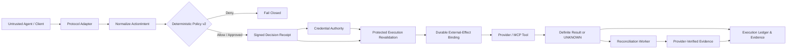

# AgentGuard

**Decision-bound credential ceilings and verifiable execution evidence for high-stakes MCP tool calls.**

[](https://github.com/TensorScholar/agentguard/actions/workflows/ci.yml)
[](https://github.com/TensorScholar/agentguard/actions/workflows/security.yml)
[](https://github.com/TensorScholar/agentguard/actions/workflows/codeql.yml)
[](https://www.python.org/downloads/)
[](LICENSE)

> **Release Status:** `v0.2.0rc3` is an engineering-validated release candidate. It implements protected MCP stdio and bounded Streamable HTTP profiles, production credential authority, durable external-effect reconciliation, and single-host multi-process coordination. Full production certification requires independent security review, long-duration operational validation, and a controlled production pilot. See [Project Status](docs/project-status.md) and [Known Limitations](docs/limitations.md).

---

## Research Status — read this before evaluating the design

A pre-registered experiment (`AG-LINEAGE-PREREG-v1.0`, "Freeze v2") was run against this
codebase to test whether AgentGuard's own execution-integrity design differentiates from a
competently implemented baseline. **It did not.** The results are stated here in full because
a negative result is a real result and hiding it would make every other number in this
README harder to trust.

```text
EXPERIMENT_RECORD                                = ACCEPTED
RESEARCH_CLAIM                                  = NOT_VALIDATED
AGENTGUARD_SPECIFIC_DIFFERENTIATION_THESIS       = FALSIFIED_WITHIN_PROTOCOL
PUBLICATION_STATUS = ELIGIBLE_FOR_TECHNICAL_REPORT_OR_NEGATIVE_RESULT_PUBLICATION
```

**In plain language.** Within that preregistration and its retained corpus, the frozen
AgentGuard-specific differentiation criterion was not demonstrated and the preregistered
falsification predicate evaluated true. In the measured arms, **both** AgentGuard and the
baseline recorded **0 primary violations** (3,600 retained trials each; 10,800 logical
trials; 0 harness-invalid), and the completion difference point estimate was `0.0`
(exact McNemar `p = 1.0`). The measured cost was asymmetric: A1–B4 slot-hold median
difference **+0.026 seconds**, a **slot-hold ratio of 6.45 favoring the no-guard baseline**.
Operator mean difference was `0.0`.

**What this does NOT mean.** Explicitly excluded, per
[the adjudication](docs/research/FREEZE_V2_RESULT_ADJUDICATION.md) §6: system execution
failure; demonstrated AgentGuard unsafety; universal equivalence between the two arms; proof
that AgentGuard can never differentiate; real-provider conclusions; production conclusions;
universal safety claims; impossibility claims. The record is *accepted* as a record — that
acceptance is explicitly not acceptance of the research thesis.

**What remains unestablished for the product.** The product thesis is a
[hypothesis](docs/PROGRESS_TRACKER.md), not a finding. No claim of demonstrated market demand,
willingness to pay, pilot success, or comparative production superiority is established. No
independent penetration test, long-duration soak test, or controlled production pilot has been
completed for `0.2.0rc3`.

**Publication note.** The result is eligible for publication as a technical report or
negative-result note. It has not been published or accepted anywhere. Follow-up work must be
a new experimental generation with a new preregistration, freeze, and seed/manifest binding;
Freeze v2 remains unchanged historical evidence.

**Consequence for adopters.** Do not adopt this project expecting a demonstrated reduction in
integrity failures relative to a competent baseline; that claim is not supported. Adopt it, if
at all, for the specific mechanisms it does implement — credential ceilings with late secret
resolution, durable effect binding with reconcile-before-retry, and the evidence-bundle /
checkpoint chain — whose value does not depend on that experiment's outcome. The core
authorization pattern (single-use signed admission ticket, digest revalidated at dispatch) is
not unique to this project; it is specified in external work including
`draft-das-agentic-execution-finality-02` and `draft-farley-acta-signed-receipts-03`.

---

## What AgentGuard Is

> AgentGuard protects high-stakes MCP tool calls by binding a short-lived, decision-scoped credential
> ceiling to a signed authorization, resolving the actual secret only at the last moment, preventing
> replay and argument mutation, and producing independently verifiable evidence of what was
> authorized versus what was observed — especially for actions that can leave ambiguous external
> effects.

That is the whole product. Four mechanisms carry it, and they are what this release line leads with:

| # | Mechanism | What it stops | Where it lives |
|---|---|---|---|
| 1 | **Decision-bound credential ceilings + late secret resolution** | An agent holding a broad long-lived secret; a caller inflating scope, audience, tenant, or lifetime beyond what was authorized. The ceiling is *derived from the signed decision*, the secret is read only at dispatch, and it is never written to the grant, the audit ledger, or the evidence bundle. | `engine/credentials.py`, `domain/credential_authority.py`, `adapters/broker/production.py` |
| 2 | **Execution-time digest revalidation + single-use claim** | Argument mutation between authorization and dispatch (an approved \$85 refund dispatched as \$850), and receipt replay. The canonical digest is recomputed from the *live* call and compared; the decision nonce is claimed atomically in one transaction. | `engine/receipts.py`, `engine/execution.py`, `adapters/storage/sqlite/state.py` |
| 3 | **Durable `ExternalEffectBinding` + `RECONCILE_BEFORE_RETRY`** | Duplicate irreversible side effects when a call times out. An ambiguous outcome stays `UNKNOWN` and blind retry is forbidden; an operator must reconcile against provider evidence first. | `domain/provider_contracts.py`, `adapters/reconciliation/`, `adapters/storage/sqlite/reconciliation.py` |
| 4 | **Hash-chained ledger + signed evidence bundles + offline verification** | Detached audit logs. What was authorized and what was observed are linked by cryptographic digest and can be verified by a third party offline, with no access to AgentGuard. | `audit.py`, `adapters/evidence/bundle.py`, `engine/attestation.py` |

The core authorization pattern — a single-use signed admission ticket, digest-revalidated at dispatch —
is **not unique to this project**; it is specified in external work (see [Research Status](#research-status--read-this-before-evaluating-the-design)). What AgentGuard adds on top is the **credential ceiling bound to that decision** and the **reconcile-before-retry contract**. Judge it on those.

**Who this is for.** A platform or security engineer who already has MCP traffic, already has an
identity story, and needs two specific things: a secret an agent cannot widen, and evidence they can
hand to an auditor without handing over the system.

**Time to grasp: ~5 minutes** (this section, then the [happy path](#the-wedge-happy-path-four-steps)).
**Time to evaluate: ~30 minutes** (run the demo, verify an evidence bundle, read
[Limitations](docs/limitations.md)).

### Not in scope for this release line

Stated plainly so nobody buys a control plane:

- **Multi-host or HA operation.** Single-host multi-process via local SQLite. No consensus, no
  cross-host coordination, no replicated state. This is an architectural boundary, not a roadmap item.
- **Full identity.** AgentGuard binds identity that a trusted integration supplies. It does not issue
  or verify workload identity (OIDC/SPIFFE/mTLS), and `DecisionReceipt` is a **bearer ticket** inside
  its validity window.
- **Generic policy-gateway competition.** This is not a policy authoring, simulation, or content-filter
  product, and it does not try to match gateway vendors on breadth.
- **A vault or IAM.** No secret storage, no token minting, no provider-native downscoping. AgentGuard
  reads a secret from a configured environment variable at dispatch and does not persist it.
- **Sandboxing or egress control.** Process isolation, filesystem MAC, and network egress are
  deployment responsibilities.
- **Production certification.** No independent penetration test, soak test, or production pilot has
  been completed for `0.2.0rc3`.

---

## AgentGuard Core and AgentGuard Reference

This repository is AgentGuard Core, the canonical runtime, at `v0.2.0rc3`. Production certification is not claimed.

`agentguard-reference` `v1.0.1` is a different artifact. It is a public standard-library example of one guarded callback. It is not a newer version of this core, and it does not carry the MCP, credential, reconciliation, or research record maintained here.

---

## The Problem This Actually Solves

An agent that can *call a tool* can move money, delete data, or send mail. When something goes wrong
it is rarely the model's reasoning — it is that **the thing that was authorized and the thing that
was executed were allowed to drift apart**, and nothing downstream can prove it afterwards.

Three failures account for most of it:

- **The agent holds a secret it should never have had.** A long-lived, broad-scope token sits in the
  agent's environment. One prompt injection later, the agent can call anything that token reaches —
  not just the refund it was approved for.
- **The approved call is not the dispatched call.** Authorization happens on one representation of the
  request; execution happens on another. An approved \$85 refund becomes \$850, and the approval
  record still says \$85.
- **A timed-out call gets retried and does it twice.** The first attempt may have committed. The
  client cannot tell, retries anyway, and now an irreversible mutation has happened twice.

And after any of it, the audit log is a separate artifact from the decision — so the question "was this
authorized?" is answered by assertion rather than by evidence.

AgentGuard's answer is narrow and mechanical: bind the credential to the decision, bind the decision
to the exact dispatched bytes, record the effect *before* it happens, and produce evidence a third
party can verify. **No generative model participates in the trusted path.**

---

## Core Security Invariant

```text
       Authorized Intent
               │
               ▼
       Clamped Authority
               │
               ▼
       Admitted Dispatch
               │
               ▼
     Evidence-Bound Outcome
──────────────────────────────────────────────────────────────────────────
✓ The dispatched normalized action must match the authorized decision, and credential use must remain within the decision's permitted authority
✓ Traffic routed through AgentGuard's protected adapters passes through the enforcement boundary (AgentGuard cannot prove hidden or alternate execution routes do not exist)
✓ Ambiguous external effects are reconciled before retry, not guessed; local evidence does not independently prove provider business truth
✓ Retained evidence is secret-minimized and integrity-protected; evidence bundles may be cryptographically signed, and signature assurance is claimed only when a trusted verification key successfully verifies the attestation
```

---

## Architectural Context: Where AgentGuard Operates

AgentGuard is an execution-integrity kernel operating at the transport and execution boundary. It complements adjacent systems across different architectural domains:

| Architectural Domain | Examples | Primary Function | AgentGuard Relationship |
| :--- | :--- | :--- | :--- |
| **Agent Frameworks & Orchestrators** | e.g., LangChain, AutoGen, CrewAI | Agent reasoning, tool selection, plan generation | AgentGuard treats the orchestrator as an **untrusted proposal generator** (independent of framework). |
| **Prompt Safety & Policy** | e.g., Llama Guard, NeMo Guardrails | Natural language content moderation, prompt filtering | Text-level filters inspect conversational content; AgentGuard enforces **deterministic execution integrity** on tool calls. |
| **Workload & Caller Identity** | e.g., SPIFFE, OIDC | Cryptographic machine and caller identity proofing | External identity tokens are validated by adapters and bound to normalized `ActionIntent` principals. |
| **Runtime Action Integrity** | **AgentGuard** | **Deterministic policy, signed receipts, credential clamping, execution digest revalidation, replay prevention** | **The enforcement kernel between the agent runtime and the tool executor.** |
| **Enterprise Secret Management** | e.g., HashiCorp Vault, AWS Secrets Manager | Enterprise secret storage and rotation | AgentGuard binds late-resolved credentials to signed decision receipts without persisting secrets. |
| **Tool Transports & Providers** | e.g., MCP Stdio/HTTP, REST APIs, Databases | Executes external business logic and side-effects | Mediated via protected MCP proxies and durable effect bindings. |

For detailed domain boundaries and separation of concerns, see [Product Boundary](docs/product-boundary.md).

---

## The Wedge Happy Path: Four Steps

This is the whole supported path. Everything else in the CLI is optional and documented in
[Advanced Surface](#advanced-surface-not-part-of-the-wedge).

```bash
python -m venv .venv && source .venv/bin/activate
pip install -e '.[http]'

# One command, ~5 seconds, 28 checks. Starts a local fake provider and the
# protected gateway, then drives the real CLIs.
python examples/harness/run_demo.py
```

It proves, with the real product code and no mocks: a side-effecting call is admitted under a
decision-scoped ceiling and dispatched; tampered arguments and replayed receipts are refused with
stable codes; an ambiguous outcome stays `UNKNOWN` instead of being guessed; reconciliation resolves
it without redispatching; and the evidence bundle verifies offline and detects tampering.

The fake provider confirms from its own ledger — that is **not** an external attestation. Read
[`examples/harness/README.md`](examples/harness/README.md) before drawing conclusions. None of this
is a certification, benchmark, or penetration test.

To drive it by hand instead, the path is:

**1. Authorize** — evaluate an untrusted intent, issue a signed `DecisionReceipt` carrying the
canonical intent digest and a `credential_ceiling`:

```bash
agentguard authorize examples/scoped-refund/request.json \
  examples/scoped-refund/policy.yaml \
  --key .agentguard/demo/private.pem \
  --ledger .agentguard/demo/audit.sqlite \
  --output decision.json
```

**2. Execute through the protected proxy** — this is the real execution sink. AgentGuard re-verifies
the receipt signature, recomputes the canonical digest **from the live call**, clamps the credential to
the ceiling, and atomically claims the nonce before the tool runs:

```bash
agentguard mcp-proxy-v2 --policy examples/scoped-refund/policy.yaml \
  --server-id customer-operations \
  --key .agentguard/demo/private.pem \
  --state .agentguard/demo/action-integrity.sqlite \
  -- <your-mcp-server-command>
```

> **`agentguard verify-execution` does not execute.** Despite the name it is a *preflight*: it
> validates authority and deliberately leaves the nonce unconsumed, printing "Execution authority
> verified; nonce not consumed. Use protected execution to claim authority." Use it to debug a
> decision, not to run a tool.

**3. Export evidence** — bundle the intent, receipt, and grant into a signed, portable manifest:

```bash
agentguard evidence-build examples/scoped-refund/request.json decision.json \
  --key .agentguard/demo/private.pem --output evidence/
```

**4. Verify offline** — a third party with only the public key and the bundle:

```bash
agentguard evidence-verify evidence/ \
  --public-key .agentguard/demo/public.pem --require-signature
# {"ok": true, "checked_artifacts": 3, "signature_verified": true}
```

**Reconciling an ambiguous effect** (operator path, step 4b) — when a dispatch times out the execution
stays `UNKNOWN` and is never auto-retried. A provider-specific reconciler must supply evidence:

```bash
agentguard reconcile-execution --execution-id <id> --evidence provider-evidence.json
```

`reconcile-execution` **refuses** file-supplied evidence that claims `PROVIDER_VERIFIED` or
`CONFIRMED_*`. Local evidence cannot establish external business truth; only a trusted
provider-specific reconciler can. See [Scenarios](docs/scenarios.md#scenario-3-external-effect-that-goes-unknown).

For the credential ceiling specifically — which is mechanism #1 and the reason to choose this project —
see [Credential Contract](docs/credential-contract.md).

---

## Architecture & Lifecycle

AgentGuard is implemented as a provider-neutral modular monolith using ports and adapters. Policy and domain semantics have zero dependencies on MCP, HTTP, SQLite, Typer, or specific cloud SDKs.



### Execution Lifecycle

The wedge path, step for step. Steps 2, 3, 5 and 6 are the four mechanisms this release leads with.

1. **Normalize:** the inbound tool proposal is parsed into a strictly typed, versioned `ActionIntent`.
2. **Authorize & sign:** deterministic default-deny Policy v2 evaluation; on allow, an Ed25519-signed
   `DecisionReceipt` is issued carrying the canonical SHA-256 intent digest **and the
   `credential_ceiling` for this specific action**. ← *mechanism 1 begins*
3. **Resolve the secret late:** the credential authority binds the grant to the decision, clamps scope,
   audience, tenant and TTL to the ceiling, and reads the actual secret **at dispatch**. The secret is
   never written to the grant, durable state, the ledger, or the evidence bundle.
4. **Revalidate & claim:** the canonical digest is recomputed **from the live call** and compared to the
   signed digest; the current policy is re-evaluated and re-matched; the nonce is claimed atomically.
   A `DecisionReceipt` can authorize **at most one** committed dispatch. ← *mechanisms 1–2*
5. **Bind before effect:** an `ExternalEffectBinding` is persisted *before* any side-effecting
   dispatch. A timeout or ambiguous failure leaves the execution `UNKNOWN`, never a guess. ← *mechanism 3*
6. **Reconcile, don't retry:** an `UNKNOWN` execution requires provider-verified evidence before any
   retry. Blind retry is forbidden by contract. A crashed executor leaves a `DISPATCHING` record that
   requires explicit operator recovery — see [Limitations](docs/limitations.md).
7. **Attest:** audit events are hash-chained and packaged into signed, offline-verifiable evidence
   bundles linking what was authorized to what was observed. ← *mechanism 4*

Full specification: [Architecture](docs/architecture.md) and [ADRs](docs/adr/).

---

## Core Capabilities

Ordered by what this release line leads with:

- **Decision-Bound Credential Ceilings:** a short-lived ceiling (audience, scopes, tenant, TTL)
  derived from the signed decision itself; the secret is resolved at the last moment from a configured
  source and never written to the grant, durable state, audit, or evidence. See
  [Credential Contract](docs/credential-contract.md).
- **Execution-Time Digest Revalidation & Single-Use Claim:** Ed25519-signed decision receipts,
  canonical-digest revalidation against the live call, and atomic nonce/lease/release reservation in
  one `BEGIN IMMEDIATE` transaction.
- **Durable Effect Binding & Reconcile-Before-Retry:** `ExternalEffectBinding` persisted before any
  side-effecting dispatch; ambiguous outcomes stay `UNKNOWN`; blind retry is forbidden; single-host
  multi-process reconciliation leases with monotonic fencing tokens.
- **Tamper-Evident Ledger & Offline-Verifiable Evidence:** secret-minimized hash-chained SQLite
  ledger, exportable signed checkpoints, signed execution attestations, and evidence bundles that a
  third party verifies with no network access.
- **Protected MCP Mediation:** bounded stdio (`2025-03-26`) and Streamable HTTP (`2026-07-28`)
  profiles with fail-closed schema/inventory handling, and `mcp-posture` bypass-route detection.

---

## Advanced Surface: Not Part of the Wedge

These are implemented, tested, and supported. They are **not** the product, they are not in the happy
path, and no claim above depends on them. Do not evaluate this project on their absence.

| Capability | Commands | Status |
|---|---|---|
| Causal execution graphs (declared ancestry only; AgentGuard does not infer hidden dependencies) | `causal-graph` | Advanced |
| Field provenance & typed-release lifecycle | `provenance-issue`, `field-release-issue` | Advanced |
| Policy counterfactual / least-authority analysis | `policy-counterfactual`, `authority-analyze`, `explain`, `simulate` | Advanced, advisory only — never issues authority |
| Delegated authority grants, leases, delegation trees | `authority-issue-root`, `authority-delegate`, `authority-lease`, `authority-reference`, `authority-revoke`, `authority-lease-revoke` | Advanced |
| Human approval receipts | `approve` | Advanced; no identity-backed approval UX is bundled |
| Checkpoint signing and cross-store verification | `audit-checkpoint-create`, `audit-checkpoint-verify`, `audit-verify` | Advanced |
| Execution attestation / verification | `attest-execution`, `verify-attestation` | Advanced |
| Preserved v0.1 compatibility CLI | `doctor`, `scan`, `gate`, `check-call`, `proxy`, `approve-call`, `approvals`, `mcp-proxy`, `report`, `verify-audit` | Legacy, retained |
| Reconciliation worker (background daemon) | `agentguard-reconcile-worker` | Operator/host concern, not per-call |

The full command list is `agentguard --help`. The count is not a feature.

---

## CLI Manual Walkthrough

Stage-by-stage inspection of the pipeline. See [Demo Walkthrough](docs/DEMO.md) for the full session.

```bash
# 1. Authorize an untrusted request -> signed DecisionReceipt + credential ceiling
agentguard authorize examples/scoped-refund/request.json examples/scoped-refund/policy.yaml \
  --output decision.json

# 2. Bounded credential grant, for contract testing only (MOCK broker — not production)
agentguard broker-demo examples/scoped-refund/request.json decision.json --output grant.json

# 3. Preflight: revalidate digest, ceiling, and policy. Does NOT execute or consume the nonce.
agentguard verify-execution examples/scoped-refund/request.json decision.json \
  examples/scoped-refund/policy.yaml --grant grant.json

# 4. Audit MCP configuration for bypass routes
agentguard mcp-posture --config examples/mcp_posture_protected.json --fail-on-bypass
```

For the **production** credential authority — the documented happy path — use
`agentguard-mcp-http` with `--credential-env`, `--credential-audience`, and `--credential-scope`.
`broker-demo` exists to exercise grant signing and ceiling enforcement without a secret source and
must not be mistaken for a production credential provider. See
[Credential Contract](docs/credential-contract.md).

---

## Product Boundary & Operational Scope

- **What AgentGuard Owns:** the credential ceiling bound to a signed decision, late secret resolution,
  execution-time digest revalidation, single-use claim, durable external-effect binding with
  reconcile-before-retry, and hash-chained evidence linking what was authorized to what was observed.
- **What AgentGuard Delegates:** model planning and orchestration (agent frameworks), caller identity
  proofing (OIDC/SPIFFE/mTLS), long-term secret storage and rotation (vaults, KMS), process isolation
  and network egress control (containers, sandboxing, firewalls), and SIEM-grade log aggregation.

Full separation-of-concerns specification: [Product Boundary](docs/product-boundary.md).

---

## Known Technical Limitations (Release Candidate `0.2.0rc3`)

- **State Model:** Validated for **single-host, multi-process** deployments via local SQLite locking. Network filesystems (NFS/CIFS) or cross-host consensus are explicitly outside the current correctness claim.
- **Credential Sourcing:** Resolves environment-held secrets late; dynamic token minting and provider-native IAM downscoping require downstream adapters.
- **Reconciliation Assurance:** Confirmed outcomes are only as authoritative as the configured provider verification contract.
- **MCP Conformance:** Protected stdio targets bounded MCP `2025-03-26`; Streamable HTTP targets bounded MCP `2026-07-28`.
- **Operational Pilot:** Production certification requires an independent security audit, long-duration soak test, and controlled production pilot.

For detailed boundary specifications, see [Threat Model](docs/threat-model.md), [Security Assumptions](docs/security-assumptions.md), and [Limitations](docs/limitations.md).

---

## Verification & Development

AgentGuard requires Python 3.11 or newer.

```bash
# Development setup with HTTP profile
python -m pip install -e '.[dev,http]'

# Run the complete test, lint, typing, and security suite
make check
```

---

## Security & License

Vulnerabilities should be reported responsibly according to [.github/SECURITY.md](.github/SECURITY.md).

Licensed under the MIT License. See [LICENSE](LICENSE).

