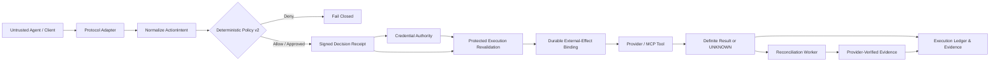

# AgentGuard

**Deterministic runtime authorization and execution-integrity controls for AI agents.**

[](https://github.com/TensorScholar/agentguard/actions/workflows/ci.yml)
[](https://github.com/TensorScholar/agentguard/actions/workflows/security.yml)
[](https://github.com/TensorScholar/agentguard/actions/workflows/codeql.yml)
[](https://www.python.org/downloads/)
[](LICENSE)

> **Release Status:** `v0.2.0rc3` is an engineering-validated release candidate. It implements protected MCP stdio and bounded Streamable HTTP profiles, production credential authority, durable external-effect reconciliation, and single-host multi-process coordination. Full production certification requires independent security review, long-duration operational validation, and a controlled production pilot. See [Project Status](docs/project-status.md) and [Known Limitations](docs/limitations.md).

---

## The Problem: Boundary Failures in Agent Execution

When autonomous AI agents interact with production infrastructure via tool transports such as MCP (Model Context Protocol), catastrophic failures rarely happen within the language model's reasoning loop. They happen at the **boundaries** between policy, identity, credentials, tool transports, and external execution:

- **Argument Mutation:** An approved action is executed with tampered parameters due to downstream prompt injection or model drift (e.g., an authorized \$85 refund is dispatched as \$850).
- **Scope & Credential Drift:** An agent acquires or uses credentials that exceed its approved audience, scope, tenant, or lifetime.
- **Action & Permit Replay:** An authorization receipt, capability lease, or execution permit is intercepted and re-executed.
- **Transport Bypass:** A client bypasses protected proxy mediation through direct or parallel transport routes.
- **Ambiguous External Effects:** An external API call times out mid-flight; the agent blindly retries, causing duplicate irreversible mutations.
- **Detached Audit Evidence:** Execution logs are unlinked from the cryptographic decision, making post-incident forensic attribution impossible.

AgentGuard addresses these integrity failures with **deterministic, fail-closed runtime controls** and stable reason codes. **No generative model participates in the trusted authorization or execution path.**

---

## Core Security Invariant

```text
       Authorized action == Credentialed action == Executed action
──────────────────────────────────────────────────────────────────────────
✓ Every protected route passes through the enforcement boundary
✓ Ambiguous external effects are reconciled before retry, not guessed
✓ Retained evidence is secret-minimized, hash-chained, and cryptographically signed
```

---

## Architectural Context: Where AgentGuard Operates

AgentGuard is an execution-integrity kernel operating at the transport and execution boundary. It complements adjacent systems across different architectural domains:

| Architectural Domain | Examples | Primary Function | AgentGuard Relationship |
| :--- | :--- | :--- | :--- |
| **Agent Frameworks & Orchestrators** | e.g., LangChain, AutoGen, CrewAI | Agent reasoning, tool selection, plan generation | AgentGuard treats the orchestrator as an **untrusted proposal generator** (independent of framework). |
| **Prompt Safety & Policy** | e.g., Llama Guard, NeMo Guardrails | Natural language content moderation, prompt filtering | Text-level filters inspect conversational content; AgentGuard enforces **deterministic execution integrity** on tool calls. |
| **Workload & Caller Identity** | e.g., SPIFFE, OIDC | Cryptographic machine and caller identity proofing | External identity tokens are validated by adapters and bound to normalized `ActionIntent` principals. |
| **Runtime Action Integrity** | **AgentGuard** | **Deterministic policy, signed receipts, credential clamping, execution digest revalidation, replay prevention** | **The enforcement kernel between the agent runtime and the tool executor.** |
| **Enterprise Secret Management** | e.g., HashiCorp Vault, AWS Secrets Manager | Enterprise secret storage and rotation | AgentGuard binds late-resolved credentials to signed decision receipts without persisting secrets. |
| **Tool Transports & Providers** | e.g., MCP Stdio/HTTP, REST APIs, Databases | Executes external business logic and side-effects | Mediated via protected MCP proxies and durable effect bindings. |

For detailed domain boundaries and separation of concerns, see [Product Boundary](docs/product-boundary.md).

---

## 60-Second Quick Start: The "Rogue Refund" Demo

AgentGuard ships with an automated scenario demonstrating real-time interception of argument tampering, scope inflation, and replay attacks:

```bash
# 1. Setup virtual environment
python -m venv .venv
source .venv/bin/activate
pip install -e .

# 2. Run the automated multi-attack verification suite
agentguard demo --output .agentguard/demo --force
```

### Inspect the Interception Results

```bash
cat .agentguard/demo/results.json
```

```json
{
  "happy_path": "authorized",
  "argument_mutation": "execution.arguments_digest_mismatch",
  "excessive_scope": "credential.scope_exceeds_decision",
  "replay": "decision_receipt.replayed",
  "audit": [
    true,
    7,
    "226e2386333128a7ac5a83184a414631209b14c2ee05f4ef211168f330ddf38a",
    null
  ]
}
```

### Offline Cryptographic Evidence Verification

Verify that the execution evidence bundle was authentically signed and untampered:

```bash
agentguard evidence-verify .agentguard/demo/evidence \
  --public-key .agentguard/demo/public.pem \
  --require-signature
```

```json
{
  "ok": true,
  "checked_artifacts": 4,
  "signature_verified": true
}
```

For the complete interactive walkthrough and step-by-step lifecycle, see [Demo Walkthrough](docs/DEMO.md).

---

## Architecture & Lifecycle

AgentGuard is implemented as a provider-neutral modular monolith using ports and adapters. Policy and domain semantics have zero dependencies on MCP, HTTP, SQLite, Typer, or specific cloud SDKs.



### Execution Lifecycle

1. **Normalize:** Inbound tool proposals are parsed into a strictly typed, versioned `ActionIntent`.
2. **Authorize:** The deterministic Policy v2 engine evaluates the intent (default-deny, blast-radius limits, verified provenance).
3. **Sign:** If permitted, AgentGuard issues an Ed25519-signed `DecisionReceipt` containing the intent's canonical SHA-256 digest and a `credential_ceiling`.
4. **Bind & Revalidate:** Before execution, AgentGuard re-verifies the canonical digest against the live call, clamps credentials to the decision ceiling, and atomically claims the decision nonce in SQLite to prevent replay.
5. **Durable Binding:** Before side-effecting dispatch, an `ExternalEffectBinding` is persisted. If the call times out or fails ambiguously, it remains `UNKNOWN`.
6. **Reconciliation:** Ambiguous executions require provider-verified reconciliation before retry; blind retries are forbidden by default.
7. **Attest:** Audit records are hash-chained and packaged into signed, verifiable evidence bundles.

For full architectural specifications, see [Architecture](docs/architecture.md) and [ADRs](docs/adr/).

---

## Core Capabilities

- **Authorization & Execution Integrity:** Deterministic default-deny Policy v2, Ed25519-signed decision receipts, execution-time canonical JSON digest revalidation (blocks parameter tampering), and atomic nonce consumption (blocks replay).
- **Protected MCP Mediation & Posture Auditing:** Protected stdio (`mcp-proxy-v2`) and Streamable HTTP (`2026-07-28`) proxies with dynamic schema hashing, fail-closed inventory, and `mcp-posture` bypass route detection.
- **Credential Clamping & Durable Reconciliation:** Late environment-backed secret resolution, exact endpoint binding, and single-host multi-process reconciliation workers coordinated via SQLite leases and monotonic fencing tokens (`RECONCILE_BEFORE_RETRY`).
- **Tamper-Evident Audit & Cryptographic Evidence:** Secret minimization at persistence boundaries, hash-chained SQLite ledgers, exportable signed checkpoints, and offline-verifiable evidence bundles.

---

## CLI Manual Walkthrough

For manual inspection of individual pipeline stages:

```bash
# 1. Authorize an untrusted request
agentguard authorize examples/scoped-refund/request.json examples/scoped-refund/policy.yaml --output decision.json

# 2. Request a bounded credential grant (demo test harness)
agentguard broker-demo examples/scoped-refund/request.json decision.json --output grant.json

# 3. Revalidate digest and execute
agentguard verify-execution examples/scoped-refund/request.json decision.json examples/scoped-refund/policy.yaml --grant grant.json

# 4. Audit MCP configuration for bypass routes
agentguard mcp-posture --config examples/mcp_posture_protected.json --fail-on-bypass
```

---

## Product Boundary & Operational Scope

- **What AgentGuard Owns:** Deterministic action authorization, signed decision receipts, execution-time parameter binding, replay prevention, credential ceilings, protected MCP transport boundaries, external-effect state machines, single-host reconciliation leasing with monotonic fencing, and hash-chained audit evidence.
- **What AgentGuard Delegates:** Model planning and task orchestration (agent frameworks), caller identity proofing (OIDC/SPIFFE), long-term secret storage and rotation (enterprise vaults), operating-system process isolation (containers/sandboxes), and distributed multi-host consensus.

---

## Known Technical Limitations (Release Candidate `0.2.0rc3`)

- **State Model:** Validated for **single-host, multi-process** deployments via local SQLite locking. Network filesystems (NFS/CIFS) or cross-host consensus are explicitly outside the current correctness claim.
- **Credential Sourcing:** Resolves environment-held secrets late; dynamic token minting and provider-native IAM downscoping require downstream adapters.
- **Reconciliation Assurance:** Confirmed outcomes are only as authoritative as the configured provider verification contract.
- **MCP Conformance:** Protected stdio targets bounded MCP `2025-03-26`; Streamable HTTP targets bounded MCP `2026-07-28`.
- **Operational Pilot:** Production certification requires an independent security audit, long-duration soak test, and controlled production pilot.

For detailed boundary specifications, see [Threat Model](docs/threat-model.md), [Security Assumptions](docs/security-assumptions.md), and [Limitations](docs/limitations.md).

---

## Verification & Development

AgentGuard requires Python 3.11 or newer.

```bash
# Development setup with HTTP profile
python -m pip install -e '.[dev,http]'

# Run the complete test, lint, typing, and security suite
make check
```

---

## Security & License

Vulnerabilities should be reported responsibly according to [.github/SECURITY.md](.github/SECURITY.md).

Licensed under the MIT License. See [LICENSE](LICENSE).

