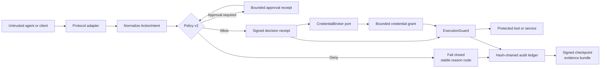
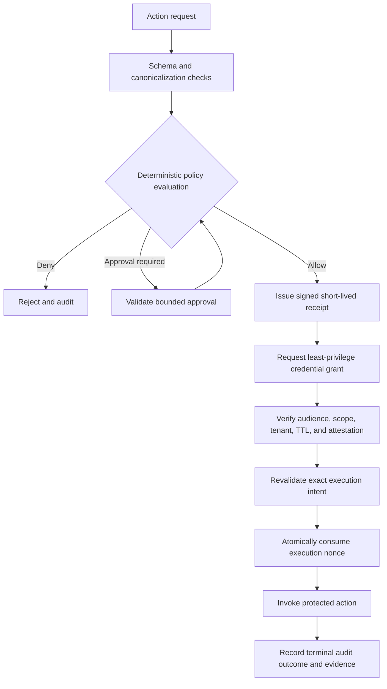
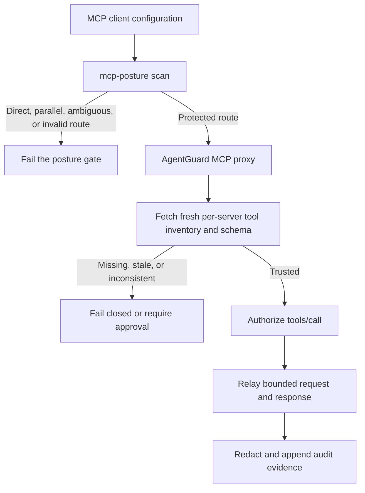
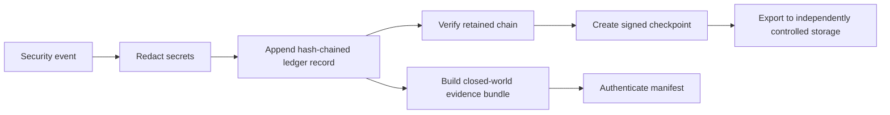

# AgentGuard

**Deterministic action authorization and execution-integrity controls for AI agents.**

> **Release status:** `v0.2.0rc2` is a hardened release candidate, not a production-certified release. The integrated secure v2 execution boundary remains the primary engineering blocker.

[](https://github.com/TensorScholar/agentguard/actions/workflows/ci.yml)
[](https://github.com/TensorScholar/agentguard/actions/workflows/security.yml)
[](https://github.com/TensorScholar/agentguard/actions/workflows/codeql.yml)

AgentGuard turns an untrusted agent action into a deterministic, signed authorization decision; constrains any credential grant to that decision; revalidates execution-time inputs; and records correlated, tamper-evident evidence.

## Why AgentGuard exists

AI-agent security controls are often split across identity, policy, credential issuance, runtime execution, and audit systems. The dangerous failures happen between those systems:

- an approved action is executed with different arguments;
- a credential exceeds the approved audience, scope, tenant, or lifetime;
- a receipt, approval, or execution permit is replayed;
- an MCP client keeps a direct route around the protected proxy;
- audit history is modified, truncated, or replaced;
- an evidence bundle is internally consistent but unauthenticated.

AgentGuard addresses these integrity gaps with deterministic controls and stable reason codes, not model judgment.

## Security objective

```text
Authorized action == Credentialed action == Executed action
Every protected MCP route passes through the enforcement path
Retained evidence is redacted, integrity-checked, and optionally signed
```

The repository implements the individual controls required for this objective. One integrated execution boundary that composes authorization, credential use, nonce consumption, protected execution, and terminal audit outcome is still open work.

## Architecture

AgentGuard is a provider-neutral modular monolith using ports and adapters. The domain and policy engine do not depend on MCP, HTTP, SQLite, Typer, OpenTelemetry, or a credential provider.



## Core workflows

### 1. Authorize, bind, and verify



### 2. Protect MCP tool calls



### 3. Preserve audit and evidence integrity



## Implemented capabilities

- Strict versioned schemas for intent, policy, receipts, credentials, execution, audit, and evidence.
- Policy v2 with default deny, deterministic deny precedence, tenant binding, provenance conditions, and blast-radius budgets.
- Ed25519-signed, short-lived, request-bound decision and approval receipts.
- Full-intent canonical digests plus diagnostic field digests.
- Approval budgets that cannot expand the original decision.
- Credential ceilings for audience, scope, tenant, TTL, and decision validity.
- Atomic issuance, approval-use, and execution-nonce state in SQLite.
- MCP stdio mediation with bounded messages, concurrent relay, stable server identity, and fail-closed schema behavior.
- Configuration posture checks for direct and parallel bypass routes.
- Sensitive-path, encoded-path, raw-host, decimal-IPv4, and cloud-metadata protections.
- Secret redaction at the audit persistence boundary.
- Owner-only permissions for private keys, ledgers, and generated evidence on POSIX systems.
- Hash-chained audit events, signed external checkpoints, and authenticated evidence manifests.
- Compatibility commands for the preserved v0.1 scanner, gate, approval, proxy, and reporting workflows.

## Quick start

AgentGuard requires Python 3.11 or newer.

```bash
python -m venv .venv
. .venv/bin/activate
python -m pip install -e .

agentguard init
agentguard demo --output .agentguard/demo
agentguard evidence-verify .agentguard/demo/evidence \
  --public-key .agentguard/demo/public.pem \
  --require-signature
```

## Authorize, broker, and verify

```bash
agentguard authorize \
  examples/scoped-refund/request.json \
  examples/scoped-refund/policy.yaml \
  --output decision.json

agentguard broker-demo \
  examples/scoped-refund/request.json \
  decision.json \
  --output grant.json

agentguard verify-execution \
  examples/scoped-refund/request.json \
  decision.json \
  examples/scoped-refund/policy.yaml \
  --grant grant.json
```

The included broker is a contract-test and demonstration adapter. It is not a production credential-provider integration.

## Check MCP enforcement posture

```bash
agentguard mcp-posture \
  --config examples/mcp_posture_protected.json \
  --fail-on-bypass
```

The command fails when it detects a direct route, an invalid route, an unverifiable proxy target, or a guarded-plus-direct duplicate.

## Product boundary

AgentGuard owns:

- action normalization and deterministic authorization;
- signed receipt and approval integrity;
- credential ceilings and grant verification;
- execution-time binding and replay controls;
- MCP enforcement posture;
- local audit, checkpoint, and evidence correlation.

AgentGuard does not own:

- model evaluation or agent orchestration;
- identity proofing or a secret vault;
- a hosted human-approval interface;
- SIEM storage or distributed consensus;
- operating-system sandboxing, process isolation, or network egress control.

A protocol adapter can enforce only traffic routed through it. Configuration scanning reduces blind spots but cannot prove that no hidden or dynamically constructed route exists.

## Current limitations

- The secure v2 execution controls are not yet composed into one integrated execution boundary.
- SQLite replay, approval, and issuance semantics are single-node.
- The HTTP package provides validation primitives, not a complete production proxy.
- No live production credential-provider adapter is included.
- No identity-backed interactive approval service is included.
- No external penetration test, long-duration soak test, or controlled production pilot has been completed.
- Multi-replica deployment requires shared transactional state, centralized signing, policy distribution, and operational rollback controls.

See [project status](docs/project-status.md) and [known limitations](docs/limitations.md) for the complete promotion boundary.

## Documentation

| Document | Purpose |
|---|---|
| [Architecture](docs/architecture.md) | Components, ports, adapters, and transaction semantics |
| [Project status](docs/project-status.md) | Validated capabilities, open findings, and promotion gates |
| [Threat model](docs/threat-model.md) | Protected properties, trust boundaries, threats, and residual risk |
| [Limitations](docs/limitations.md) | Explicit technical and operational constraints |
| [Production deployment](docs/production-deployment.md) | Deployment profiles and promotion requirements |
| [Release process](docs/release-process.md) | Release validation and artifact handling |
| [v1 to v2 migration](docs/migration-v1-to-v2.md) | Compatibility and migration guidance |
| [Demo](docs/DEMO.md) | Local demonstration workflow |

## Development

```bash
python -m pip install -e '.[dev]'
make check
```

Security-sensitive changes must include tests for allow, deny, replay, mutation, stale-state, and failure behavior where applicable. See [.github/CONTRIBUTING.md](.github/CONTRIBUTING.md).

## Security

Do not report vulnerabilities in public issues. Follow [.github/SECURITY.md](.github/SECURITY.md).

## License

MIT. See [LICENSE](LICENSE).
